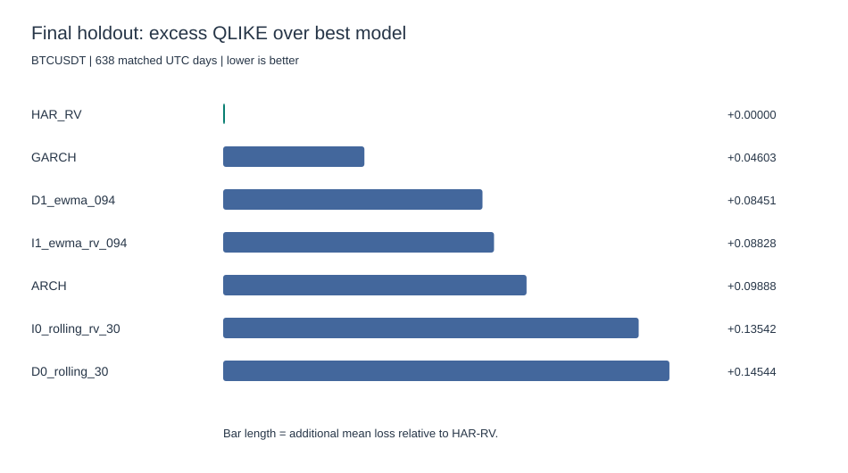
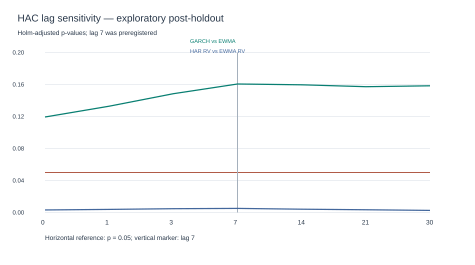
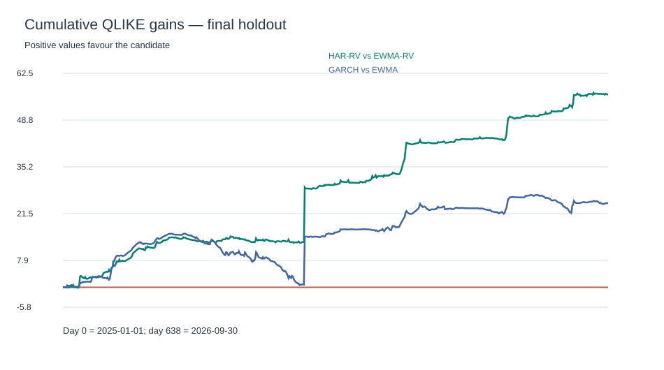

# HC-BTCVOL-001 — Independent Numerical Review

**Status:** post-holdout exploratory audit, not peer-reviewed.

**Instrument:** Binance Spot BTCUSDT.

**Study period:** 2020-01-01 to 2026-09-30 UTC.

**First-look holdout:** 638 daily observations, 2025–2026.

## 1. Confirmatory results

The original model and inference specifications were
frozen before the holdout was opened.

The loss is QLIKE: log(forecast) + RV/forecast.

Two-sided Diebold–Mariano-style comparisons use
Newey–West HAC with seven lags and Holm correction
across exactly two registered hypotheses.

| Primary comparison | Mean gain | Holm p | Bootstrap 95% CI |
|---|---:|---:|---|
| HAR-RV vs EWMA-RV | +0.08827622 | 0.00514178 | [0.04149297659951964, 0.15364045868855053] |
| GARCH vs EWMA | +0.03848423 | 0.16063413 | [-0.009238035478517682, 0.10013922349910497] |

HAR-RV improves QLIKE relative to EWMA-RV under the
preregistered confirmatory procedure.

GARCH's numerical improvement over daily EWMA is
not statistically significant at the familywise 5% level.

The supplementary bootstrap intervals are not the
confirmatory decision rule.

## 2. Model ranking

| Model | Mean QLIKE |
|---|---:|
| HAR_RV | -6.63846313 |
| GARCH | -6.59243329 |
| D1_ewma_094 | -6.55394906 |
| I1_ewma_rv_094 | -6.55018691 |
| ARCH | -6.53958202 |
| I0_rolling_rv_30 | -6.50303889 |
| D0_rolling_30 | -6.49302190 |

The ranking is descriptive: no registered pairwise
significance test between HAR-RV and GARCH was performed.

## 3. Methodology and numerical verification

The dataset contains 82 source archives, 462 missing
five-minute observations, seven shortened candles,
and one candle with negative duration.

The 16 incomplete daily RV observations are retained
as missing, without price interpolation.

Daily RV equals the sum of 288 squared five-minute
log returns, with the preceding daily close as anchor.

The first-look holdout contains 638 valid RV targets.

An independently written implementation reproduced:

- all 638 daily RV targets from five-minute source closes;
- rolling variance and the two EWMA recursions;
- ARCH and GARCH forecasts from stored fitted parameters;
- all HAR OLS forecasts and training-only smearing;
- all seven QLIKE means and the two DM–HAC/Holm results.

**Independent-verification boundary:** this replay
does not separately solve and validate every GARCH QMLE
optimization problem with a second solver.
External peer review has not yet occurred.

## 4. Important model specification distinction

Our log-HAR specification uses yesterday's log RV,
the mean of the previous seven log RV observations,
and the mean of the previous thirty log RV observations.

It is not mathematically identical to taking the
logarithm of weekly and monthly arithmetic-average RV.

Consequently, it should be called the
**implemented log-HAR-RV variant**, not an exact
replication of the canonical Corsi specification.

The model uses 730 calendar days for the training
window, removes inadmissible training observations,
and requires at least 500 training rows.

The retransformation applies Duan smearing computed
from training residuals only.

## 5. Post-holdout statistical sensitivity

All alternative HAC bandwidths, bootstrap lengths,
year subdivisions and exclusions below are exploratory.

| HAC lag | HAR Holm p | GARCH Holm p |
|---:|---:|---:|
| 0 | 0.003176 | 0.119348 |
| 1 | 0.003875 | 0.132885 |
| 3 | 0.004720 | 0.148493 |
| 7 | 0.005142 | 0.160634 |
| 14 | 0.004096 | 0.159653 |
| 21 | 0.003463 | 0.157270 |
| 30 | 0.002597 | 0.158397 |

| Bootstrap block days | HAR 95% CI | GARCH 95% CI |
|---:|---|---|
| 7 | [0.041252693255733136, 0.15687196080402158] | [-0.007101436022069216, 0.09565523130351718] |
| 14 | [0.04228216524986153, 0.15298758613497845] | [-0.009573853161926181, 0.09899061005915434] |
| 21 | [0.03997436594715828, 0.15402746244936988] | [-0.008893432801161016, 0.09624137625913179] |
| 28 | [0.04273699170200916, 0.15046896216250674] | [-0.010283731704342063, 0.09729274810136583] |

These alternative confidence intervals use 2,000
bootstrap repetitions each. The original frozen
bootstrap used 14-day blocks and 10,000 draws.

| Year | Days | HAR mean gain | GARCH mean gain |
|---:|---:|---:|---:|
| 2025 | 365 | +0.088429 | +0.045657 |
| 2026 | 273 | +0.088073 | +0.028894 |

### Extreme-observation influence

The next means exclude the highest 1% or 5%
by RV, or by the absolute paired loss differential.

These subsamples were chosen post-holdout, and no
additional confirmatory p-values are assigned.

| Contrast | Exclusion | N | Mean gain |
|---|---|---:|---:|
| GARCH_vs_EWMA | exclude_top_1pct_rv | 631 | +0.009844 |
| GARCH_vs_EWMA | exclude_top_1pct_abs_loss_diff | 631 | +0.000755 |
| GARCH_vs_EWMA | exclude_top_5pct_rv | 606 | -0.008565 |
| GARCH_vs_EWMA | exclude_top_5pct_abs_loss_diff | 606 | -0.015918 |
| HAR_RV_vs_EWMA_RV | exclude_top_1pct_rv | 631 | +0.048492 |
| HAR_RV_vs_EWMA_RV | exclude_top_1pct_abs_loss_diff | 631 | +0.040584 |
| HAR_RV_vs_EWMA_RV | exclude_top_5pct_rv | 606 | +0.025258 |
| HAR_RV_vs_EWMA_RV | exclude_top_5pct_abs_loss_diff | 606 | +0.019133 |

## 6. Scientific limitations

**Measurement risk.** Five-minute realized variance
is a proxy for latent conditional variance. Noise,
jumps and exchange microstructure can matter.

**External validity.** One venue, one instrument,
one holdout period. Results do not establish
performance in future or cross-venue market regimes.

**Model assumptions.** ARCH/GARCH use zero-mean
Gaussian QMLE. Heavy tails, leverage effects,
alternative forecast horizons and model families
have not been prospectively adjudicated.

**Inference.** HAC standard errors are asymptotic.
Alternative bandwidths and bootstrap lengths were
examined post-holdout and cannot alter the original
confirmatory interpretation.

**Methodological independence.** Internal numerical
replication is not an external academic review or
institutional model-risk certification.

**Economic relevance.** Statistical forecast
accuracy does not establish investment profitability.

## 7. Selected academic references

1. Andersen, Bollerslev, Diebold & Labys (2003),
   *Modeling and Forecasting Realized Volatility*,
   Econometrica.
   https://doi.org/10.1111/1468-0262.00418

2. Bollerslev (1986), *Generalized Autoregressive
   Conditional Heteroskedasticity*, Journal of
   Econometrics.
   https://doi.org/10.1016/0304-4076(86)90063-1

3. Corsi (2009), *A Simple Approximate Long-Memory
   Model of Realized Volatility*, Journal of
   Financial Econometrics.
   https://doi.org/10.1093/jjfinec/nbp001

4. Diebold & Mariano (1995), *Comparing Predictive
   Accuracy*, Journal of Business & Economic Statistics.
   https://doi.org/10.1080/07350015.1995.10524599

5. Duan (1983), *Smearing Estimate: A Nonparametric
   Retransformation Method*, JASA.
   https://doi.org/10.1080/01621459.1983.10478017

6. Holm (1979), *A Simple Sequentially Rejective
   Multiple Test Procedure*, Scandinavian Journal
   of Statistics.
   https://www.jstor.org/stable/4615733

7. Newey & West (1987), *A Simple, Positive
   Semi-Definite, Heteroskedasticity and
   Autocorrelation Consistent Covariance Matrix*,
   Econometrica.
   https://doi.org/10.2307/1913610

8. Patton (2011), *Volatility Forecast Comparison
   Using Imperfect Volatility Proxies*,
   Journal of Econometrics.
   https://doi.org/10.1016/j.jeconom.2010.03.034

## 8. Research integrity

This review is explicitly post-holdout.

The original frozen model specifications and
confirmatory results remain unchanged.

The analyses above are not an additional
preregistered experiment.

External replication and critical review remain
necessary before claiming institutional validation.
